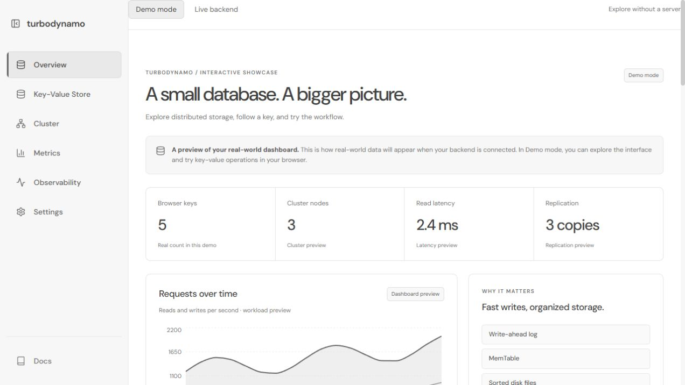
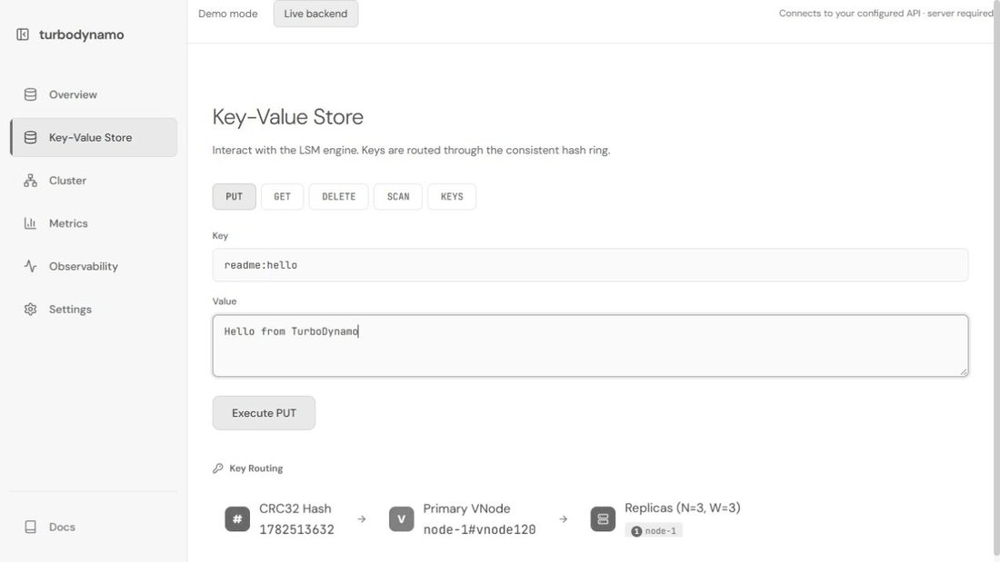
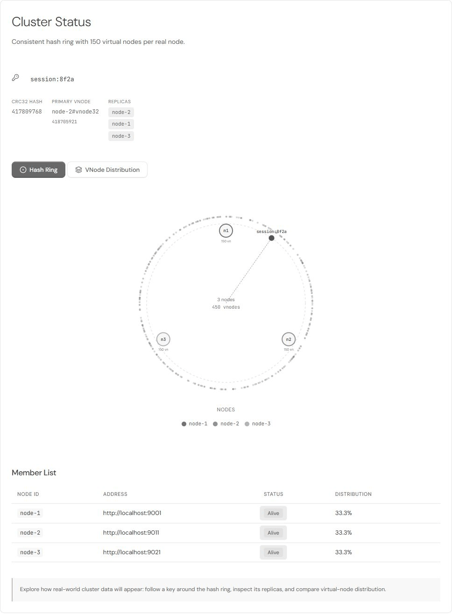
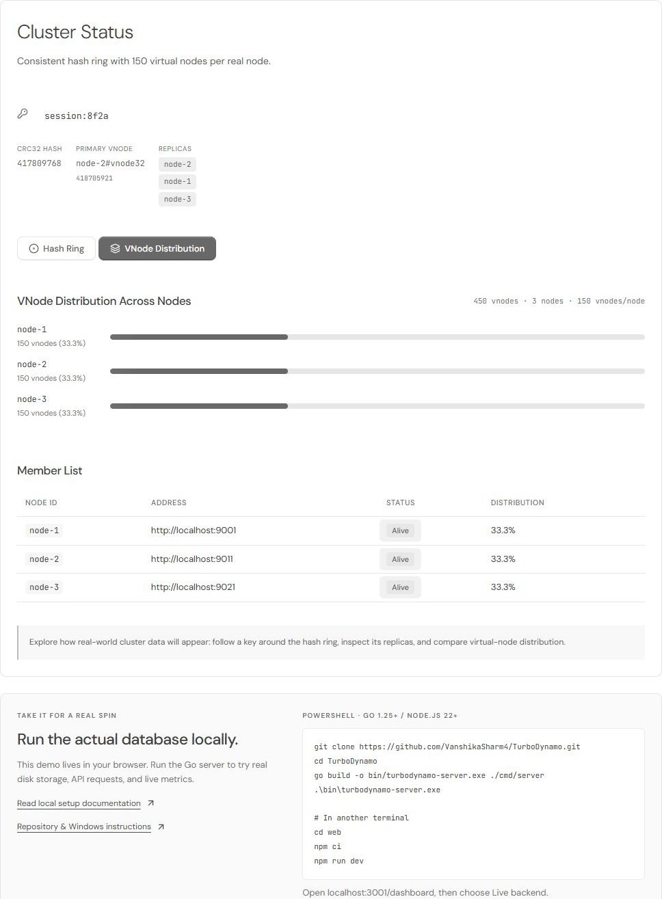
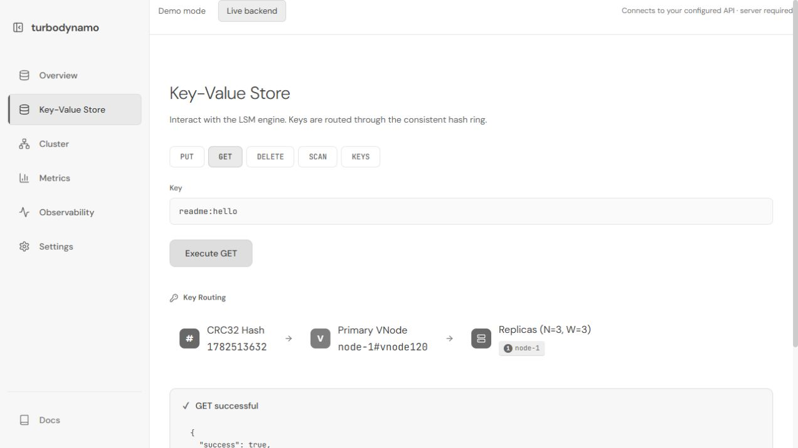
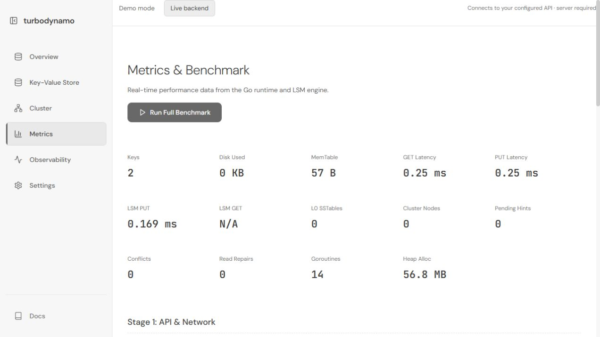
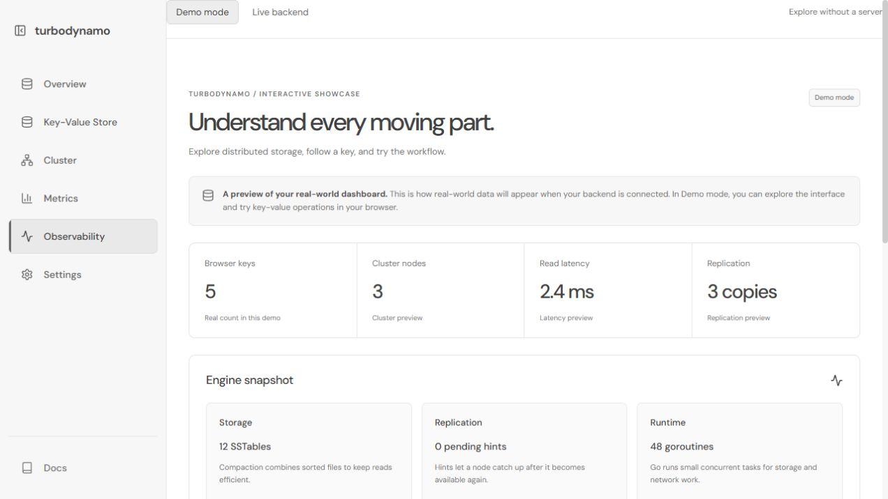
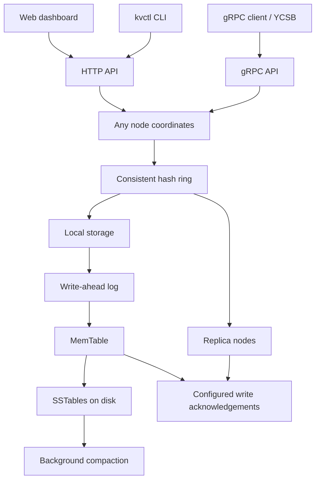
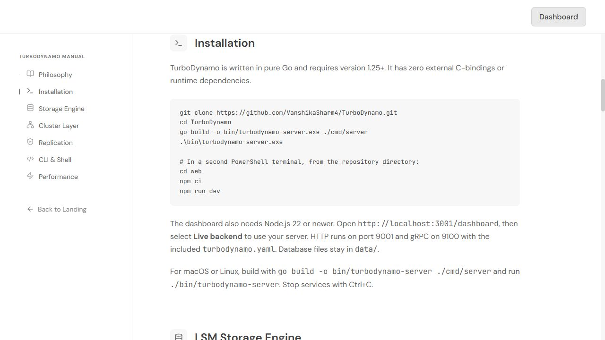

<div align="center">

# TurboDynamo

### Distributed storage. Visible internals. Real engineering.

A Dynamo-inspired key-value database built in Go, with a custom LSM storage engine, a masterless cluster, and an interactive dashboard that makes the architecture tangible.

[](https://github.com/VanshikaSharm4/TurboDynamo/actions/workflows/ci.yml)


[See it in action](#see-it-in-action) · [Explore the architecture](#how-it-works) · [Run it locally](#run-locally-on-windows) · [Documentation](docs/ARCHITECTURE.md)

</div>



> **A database you can explore, not just query.** Follow a key around a hash ring. Watch a write reach the server. Inspect storage, replication, and runtime metrics from one clean interface.

## What is TurboDynamo?

TurboDynamo stores data as **keys and values**. Save `user:1001` with a profile, fetch it later, update it, or delete it. Values can be text, serialized JSON, or application bytes.

Under that simple interface sits the interesting part: a storage engine that organizes writes into sorted files, and a distribution layer that places copies across cooperating servers.

You can run one node to explore local storage, or launch three nodes to experiment with partitioning, replication, and failure recovery. Use the web dashboard, the `kvctl` terminal client, HTTP requests, or gRPC clients against the same backend.

```text
user:1001       {"name":"Alice","plan":"Pro"}
product:42      {"name":"Mechanical keyboard","stock":24}
config:theme   light
```

## See it in action

### Write it. Read it. Delete it.

The recording below shows **actual requests to the running Go backend**, through the Live backend interface. The server accepts a write, returns the saved entry, and acknowledges its deletion.



The HTTP response represents byte values as Base64. For example, `SGVsbG8gZnJvbSBUdXJib0R5bmFtbw==` decodes to `Hello from TurboDynamo`. The CLI renders this value as readable text.

### Watch a key find its place

Enter a key and the real browser-side CRC32 calculation finds its position, primary virtual node, and replica order. Switch to distribution to inspect virtual-node ownership.

This recording uses the **three-node dashboard preview**; it demonstrates the interface and routing calculation without claiming that replication is taking place in the browser.



## Built to go beyond basic CRUD

| Capability | What makes it interesting |
|---|---|
| **Custom LSM storage engine** | Recent writes enter a MemTable; sorted disk files and background compaction organize persistent data. |
| **Write-ahead logging** | A recovery log lets the engine replay writes after restart. Sync behavior is configurable. |
| **Leveled and tiered compaction** | Two strategies for merging SSTables and managing the storage layout. |
| **Bloom filters and caches** | Avoid unnecessary disk lookups and reuse frequently accessed data. |
| **Masterless cluster** | Any node can coordinate requests; the architecture does not depend on one permanent primary. |
| **Consistent hashing** | CRC32 placement with configurable virtual nodes distributes keys across members. |
| **Configurable replication and quorums** | Choose replica count and read/write acknowledgement requirements for your workload. |
| **Vector clocks** | Track causal relationships and identify concurrent versions. |
| **Read repair and hinted handoff** | Repair stale replicas and retry delivery to nodes that were unavailable. |
| **Merkle-tree reconciliation** | Compare hashes to help identify divergent data. |
| **Gossip and failure detection** | Exchange membership information and assess node health using a phi-accrual detector. |
| **HTTP, gRPC, and CLI** | Use the interface that fits your application or workflow. |
| **Prometheus and tracing support** | Inspect request, storage, cluster, and Go runtime behavior. |
| **YCSB-style workloads** | Exercise read-heavy, mixed, and write-heavy traffic with the included benchmark client. |

These are implemented project capabilities, not a promise of production readiness or a particular throughput. Correct behavior depends on configuration, failure conditions, and workload.

## A dashboard with something to show

### An overview that explains the system

The dashboard opens in **Demo mode**, with a complete walkthrough: request history, a storage pipeline, a key-value playground, and a cluster preview. Small explanations connect each visualization to the underlying engineering.

Demo operations work in browser storage. Live mode connects the same frontend to an actual TurboDynamo backend. If a backend is unavailable, visitors get setup guidance and a route back to the demo.

| View | What you can explore |
|---|---|
| **Overview** | The storage story, workload preview, and key-value playground in one place. |
| **Key-Value Store** | PUT, GET, DELETE, prefix SCAN, and KEYS. |
| **Cluster** | Hash ring, key routing, replica order, virtual-node distribution, and membership. |
| **Metrics** | Request rates, latency, storage sizes, key counts, and Go runtime metrics. |
| **Observability** | Engine snapshots, activity previews, and live monitoring when connected. |
| **Settings** | Node and storage information; configuration is edited in YAML. |
| **Docs** | Installation, architecture, storage, clustering, replication, and CLI usage. |

### One cluster view, two ways to explore

Demo and live modes share the **same Cluster Status component**. The preview supplies an example topology; live mode supplies the connected server's membership data.

<table>
<tr>
<td width="55%">

</td>
<td width="45%">

</td>
</tr>
</table>

*Cluster preview: 150 virtual nodes per node, 450 in total. Node labels are spaced for visibility; the outer ring shows virtual-node positions.*

### Real backend responses and real metrics





*Live screenshots capture a small local session. They are not benchmark results.*

### Make the internals understandable



*The preview shows how real-world data will appear. Connect your own backend to inspect its actual telemetry.*

## How it works



**The write path:** the coordinator determines ownership, records local writes, updates memory, and coordinates replica acknowledgements according to the configured quorum.

**The read path:** the engine checks recent in-memory data and sorted disk files. Bloom filters help eliminate files that cannot contain the key. Cluster reads can compare replicas and repair older data.

**The recovery story:** WAL replay restores logged entries after restart. Background processes support compaction, replica catch-up, and reconciliation.

For the details, see the [architecture guide](docs/ARCHITECTURE.md) and [system diagrams](docs/UML_DIAGRAMS.md).

## Explore the code

```text
api/                 Protobuf schema and generated gRPC bindings
cmd/server/          Server entry point and HTTP handlers
cmd/kvctl/           CLI commands, interactive shell, and clients
cmd/ycsb/            Benchmark client
internal/store/      Storage interfaces, WAL, and local engines
internal/store/lsm/  MemTables, SSTables, caches, and compaction
internal/cluster/    Membership, replication, repair, and coordination
internal/ring/       Consistent hash ring
internal/merkle/     Merkle-tree implementation
internal/metrics/   Prometheus instrumentation
web/                React + TypeScript dashboard
configs/            Server and cluster configurations
.github/workflows/  Builds, tests, coverage, lint, and integration checks
```

## Engineering you can verify

The CI workflow checks tests with race detection, coverage, formatting, static analysis, Linux/macOS builds on amd64/arm64, a three-node integration workload, and the Docker image. The badge above links to the current result.

The repository includes benchmarks so you can measure **your own machine and configuration**. Throughput varies with hardware, payload size, durability settings, batch sizes, and quorum choices. Dashboard preview values are interface examples, not performance evidence.

## Documentation

| Guide | What it covers |
|---|---|
| [Architecture](docs/ARCHITECTURE.md) | Storage internals, distribution, and replication. |
| [Usage](docs/USAGE.md) | API and command-line usage. |
| [Deployment](docs/DEPLOYMENT.md) | Existing deployment notes and infrastructure examples. |
| [Multiple machines](docs/MULTI-MACHINE-SETUP.md) | Cluster networking across machines. |
| [System diagrams](docs/UML_DIAGRAMS.md) | Component relationships and request flow. |



## Project context

TurboDynamo builds on the upstream [Kasoku project](https://github.com/DevLikhith5/Kasoku), with restored application sources, consistent TurboDynamo branding, runtime fixes, an interactive frontend showcase, and CI repairs.

Original legal notices remain in [docs/LICENSE](docs/LICENSE). That file contains a proprietary notice; a public GitHub repository does not itself grant permission to reuse or redistribute the software.

---

## Run locally on Windows

### 1. Install the prerequisites

- **Git** to clone the repository.
- **Go 1.25 or newer** for the backend and CLI.
- **Node.js 22 or newer**, with npm, for the dashboard.

### 2. Clone the project

```powershell
git clone https://github.com/VanshikaSharm4/TurboDynamo.git
cd TurboDynamo
```

### 3. Build and start the backend

Run from the repository root:

```powershell
go build -o bin/turbodynamo-server.exe ./cmd/server
go build -o bin/kvctl.exe ./cmd/kvctl
.\bin\turbodynamo-server.exe --config turbodynamo.yaml
```

Keep this terminal open. The included configuration uses:

| Service | Address |
|---|---|
| HTTP API | `http://127.0.0.1:9001` |
| Health check | `http://127.0.0.1:9001/health` |
| gRPC | `127.0.0.1:9100` |
| Persistent data | `./data/` |

### 4. Start the dashboard

Open a **second terminal**, navigate to the cloned repository, then run:

```powershell
cd web
npm ci
npm run dev
```

Open **http://127.0.0.1:3001/dashboard**. Choose **Demo mode** for the browser playground or **Live backend** to use the server you started.

### 5. Try real data

From another terminal in the repository root:

```powershell
.\bin\kvctl.exe --addr http://127.0.0.1:9001 put user:1 "Alice"
.\bin\kvctl.exe --addr http://127.0.0.1:9001 get user:1
.\bin\kvctl.exe --addr http://127.0.0.1:9001 scan user:
.\bin\kvctl.exe --addr http://127.0.0.1:9001 keys
.\bin\kvctl.exe --addr http://127.0.0.1:9001 shell
```

The live dashboard and remote CLI talk to the same server, so a key written through one is available through the other.

### macOS and Linux

After cloning, build and start the backend with:

```bash
go build -o bin/turbodynamo-server ./cmd/server
go build -o bin/kvctl ./cmd/kvctl
./bin/turbodynamo-server --config turbodynamo.yaml
```

In another terminal, start the dashboard with the same `cd web`, `npm ci`, and `npm run dev` commands. Use `./bin/kvctl` instead of `.\bin\kvctl.exe`.

### Run a three-node cluster

Stop the single-node server first. From the repository root, start each command in a separate terminal:

```powershell
.\bin\turbodynamo-server.exe --config configs/bench-cluster-node1.yaml
.\bin\turbodynamo-server.exe --config configs/bench-cluster-node2.yaml
.\bin\turbodynamo-server.exe --config configs/bench-cluster-node3.yaml
```

On macOS/Linux, replace `.\bin\turbodynamo-server.exe` with `./bin/turbodynamo-server`.

| Node | HTTP | gRPC | Data directory |
|---|---|---|---|
| 1 | `localhost:9001` | `localhost:9100` | `data/bench-node1` |
| 2 | `localhost:9011` | `localhost:9101` | `data/bench-node2` |
| 3 | `localhost:9021` | `localhost:9102` | `data/bench-node3` |

The included benchmark configurations use **N=3, W=1, R=1** for eventual-consistency experiments. Edit `replication_factor`, `quorum_size`, and `read_quorum` in the YAML files to explore other choices. An overlapping read/write quorum requires `W + R > N`; this alone is not a blanket guarantee of linearizability.

With all three nodes running, open **Cluster** in Live backend mode.

### Run checks and a benchmark

```powershell
go test ./... -timeout 10m
go vet ./...
npm --prefix web run build

go build -o bin/ycsb-bench.exe ./cmd/ycsb
.\bin\ycsb-bench.exe -nodes "localhost:9100,localhost:9101,localhost:9102" -workers 20 -batch 1 -recordcount 10000 -fieldlength 100 -dur 5 -workload b
```

Run the benchmark only after starting the three-node cluster. The race check used in Linux CI is `go test -race -timeout 10m ./...`; it needs a supported C compiler and CGO enabled.

### GitHub Pages

The repository includes `.github/workflows/pages.yml`, which builds the React frontend and publishes `web/dist`.

1. Open **Repository Settings → Pages**.
2. Under **Build and deployment → Source**, choose **GitHub Actions**.
3. Open **Actions → Deploy frontend to GitHub Pages** and run the workflow, or push a frontend change to `main`.
4. Visit **https://vanshikasharm4.github.io/TurboDynamo/** after deployment succeeds.

The workflow configures the repository base path and includes a fallback for client-side routes. Publishing `main` directly from the repository root serves documentation rather than the built application. GitHub Pages hosts the frontend only; Demo mode works without the Go backend.

### Frontend-only deployment

For a static host, use `web` as the project root, `npm ci && npm run build` as the build command, and `dist` as the publish directory. Configure an SPA fallback so `/dashboard` and `/docs` serve `index.html`.

Demo mode needs no backend. Live mode needs a reachable server: the development proxy is available with `npm run dev`, not on a static host or through `npm run preview`. A separately hosted backend can be selected at build time with `VITE_API_URL`, with HTTPS and appropriate CORS configuration.

### Stop, restart, and troubleshoot

- **Stop:** press Ctrl+C in each server/frontend terminal.
- **Keep your keys:** retain `data/` when restarting. Do not open that same directory in CLI offline mode while its server is running.
- **Backend setup screen:** verify the server is running, check `/health`, and retry the connection.
- **Port already in use:** stop the earlier process or update the configuration and the frontend proxy together.
- **Dashboard works but no real keys appear:** select Live backend; Demo mode has separate browser-local data.
- **Production use:** passing CI is a development milestone. Evaluate durability settings, failure behavior, authentication, backups, and operational requirements before using important data.
